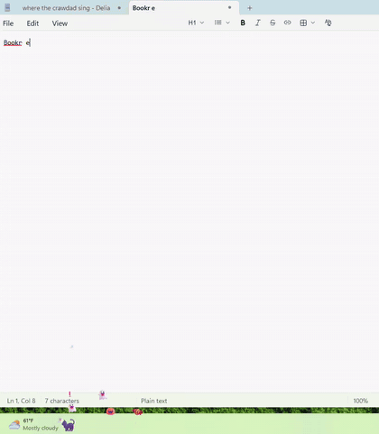

# 🌸 Emoji Float



Hey, this is my emoji floater! Add it to your work or personal laptop and your typing gets a lot more fun.

I built it one evening while working. What a world we live in! There are no dinosaurs, but there are 🎃 pumpkins for fall, ⛄ snowmen for winter, a 🧸 bear for Valentine's, and lots more.

## What it does
Cute emoji float up from the left side of your taskbar while you type. The faster you type, the more of them there are:

☁️ clouds → 🌸 flowers → 💕 hearts → 💖 a full-on party

- 🐿️ **A little critter** lives on your taskbar. It naps when you're idle and zooms around when you type fast.
- 🍂 **Leaves, petals and candy** pile up on the taskbar until the wind blows them away. In winter, ❄️ snow drifts build up.
- 🎨 **Themes:** Spring, Fall, Winter, Halloween and Valentine. **Auto** picks one based on the date.
- 📊 **Today's stats:** hover over the tray icon to see your keys typed, top wpm and 🎉 parties.

It only counts *how fast* you type. Which keys you press is never stored.

## Get it
**Easy way:** download [`EmojiFloat.exe`](https://github.com/psvlnandu/emoji-float/releases/latest/download/EmojiFloat.exe) from the latest release, put it somewhere permanent (not Downloads), and double-click it. Windows may say *"Windows protected your PC"*. If it does, click **More info → Run anyway**. That happens with any homemade app.

**Customize it:** change the emoji, critters or colors in the `THEMES` section at the top of `emoji_float.pyw`. Then run:
```
pip install PyQt6
pythonw emoji_float.pyw
```

**Build your own .exe:**
```
pip install pyinstaller
python -m PyInstaller --noconfirm --onefile --windowed --noupx --name EmojiFloat --icon emoji_float.ico emoji_float.pyw
```

## Using it
Right-click the tray icon to tick **Start with Windows** (so it comes back after a restart), switch themes ✨, pause it, or quit.

> On a work laptop, check that your company allows running your own apps first. Some antivirus tools are wary of anything that listens to the keyboard.

Windows only. Hope it makes you smile 💖
